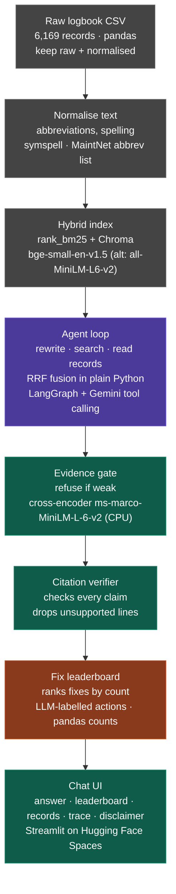

# Maintenance Copilot: Agentic RAG over Aviation Logbooks

**NexAI Hack 2026 · Track 1 (Agentic AI & Intelligent Automation) · Problem Statement 1.3**

> ⚠️ **Disclaimer:** This is a decision-support prototype built for a hackathon. Its answers are **not approved maintenance procedures** and must not be used for airworthiness decisions. Always follow the aircraft maintenance manual and your organisation's approved procedures.

- **Live demo:** _TBD (Hugging Face Spaces URL)_
- **Demo video:** _TBD_
- **Development log:** [DEV_LOG.md](DEV_LOG.md)

---

## Problem statement

When a technician sees a fault, the fastest fix is often buried in years of past logbook entries. Logbook text is terse, abbreviation-heavy and misspelled (`CYL 2 LOWER PLUG FOULED`, `R&R`, `A/C`), so plain embedding search misses obvious matches. In maintenance, a confident wrong answer is worse than none.

**Goal:** a copilot that takes a fault description, finds similar past records, summarises the likely causes and the actions that fixed them, **cites every record ID it relied on**, and says **"insufficient evidence"** instead of inventing a procedure.

## Solution overview

- **Text normalisation** expands abbreviations and fixes spelling, while the raw text is kept for display.
- **Hybrid retrieval** combines BM25 keyword search with dense embeddings, merged by Reciprocal Rank Fusion (RRF).
- **An agentic loop** (LangGraph + Gemini) rewrites the query, runs several searches, reads records and decides whether it has enough evidence.
- **Trust layer:**
  - An evidence gate (cross-encoder) refuses when matches are weak.
  - A citation verifier drops claims that the cited records don't support.
- **Fix leaderboard (standout feature):** an evidence card above the answer that groups the actions taken in similar past cases and ranks them by frequency:
  ```
  Based on 9 similar records:
  • Replaced spark plugs        5 cases [rec 100112, 100487, …]
  • Cleaned / regapped plugs    3 cases [rec 100903, …]
  • Replaced ignition lead      1 case  [rec 102201]
  ```
- **Chat UI** shows the answer, the leaderboard, the cited records side by side, the agent's tool-call trace and the disclaimer.

## Architecture



_Gray: offline · Purple: reasoning · Teal: trust layer · Coral: standout feature_

### Agent capabilities
- Rephrase or expand the query (e.g. "cylinder" → "CYL")
- Run several searches and merge the results
- Filter by part, component or fault type
- Decide the evidence is insufficient and search again
- Count or summarise across many records ("how often does this fault recur?")

### Agent tools (minimum)
| Tool | Purpose |
|---|---|
| `search_records(query, k, filters)` | Hybrid BM25 + dense search fused with RRF |
| `get_record(ident)` | Fetch a full record by its `IDENT` |

## Technology stack

| Layer | Tools |
|---|---|
| Language | Python 3.14 |
| Data | pandas, numpy |
| Normalisation | symspellpy, MaintNet abbreviation list |
| Keyword search | rank-bm25 |
| Embeddings and re-ranking | sentence-transformers (`BAAI/bge-small-en-v1.5`, `cross-encoder/ms-marco-MiniLM-L-6-v2`) |
| Vector store | ChromaDB |
| Agent | LangGraph, langchain-core |
| LLM | Google Gemini (free tier) via langchain-google-genai |
| UI | Streamlit |
| Hosting | Hugging Face Spaces |

All pinned versions are in [requirements.txt](requirements.txt).

## Setup and running

**Prerequisites:** Python 3.14 and a free Gemini API key from [Google AI Studio](https://aistudio.google.com/apikey).

1. Create and activate the virtual environment:
   ```bash
   python3 -m venv venv
   ```
   ```bash
   source venv/bin/activate
   ```
2. Install the dependencies:
   ```bash
   pip install -r requirements.txt
   ```
3. Configure your credentials:
   ```bash
   cp .env.example .env
   ```
   Then edit `.env` and set `GOOGLE_API_KEY`. `GEMINI_MODEL` defaults to `gemini-3.5-flash`, with `gemini-flash-lite-latest` as an automatic fallback when the main model is overloaded.
4. Put the dataset at `Aircraft_Annotation_DataFile.csv` in the project root.
5. Build the normalised records and the vector index (about 15 s):
   ```bash
   python -m scripts.build_index
   ```
6. *(Optional, already committed)* Re-label the actions for the fix leaderboard (about 50 Gemini calls):
   ```bash
   python -m scripts.label_actions
   ```
7. Run the app:
   ```bash
   streamlit run app.py
   ```
   If the index is missing, the app builds it on first start.
8. Run the evaluations:
   ```bash
   python -m eval.run_retrieval_eval --split test
   ```
   ```bash
   python -m eval.run_agent_eval
   ```

## Project structure

```
app.py                     Streamlit chat UI (answer, leaderboard, records, trace)
copilot/
  config.py                paths, model names, thresholds
  normalize.py             abbreviation expansion + corpus spell-fixer + BM25 tokens
  labels.py                rule-based component / fault-type / action-type labels
  retrieval.py             BM25 + Chroma dense search, RRF fusion, cross-encoder rerank
  tools.py                 agent tools: search_records, get_record, count_similar
  agent.py                 LangGraph loop + evidence gate + citation verifier
  leaderboard.py           fix leaderboard (pandas group-by over offline labels)
  llm.py                   Gemini with automatic fallback model
  resources/english_words.txt   words the spell-fixer must never "correct"
scripts/
  build_index.py           offline: CSV -> data/records.csv + index/chroma
  label_actions.py         offline: Gemini labels each action -> data/action_labels.csv
eval/
  test_questions.json      15 answerable + 5 unanswerable questions (written before tuning)
  run_retrieval_eval.py    hit@5 per retriever + score distributions
  run_agent_eval.py        end-to-end: answered, citation precision, refusals
data/                      generated records + action labels (committed)
```

## Dataset attribution and licence

- **Dataset:** MaintNet aviation maintenance logbook: 6,169 records (`IDENT`, `PROBLEM`, `ACTION`) of free-text problems and the actions taken, from the University of North Dakota Aviation Program.
- **Source:** [MaintNet](https://people.rit.edu/fa3019/MaintNet/). A Kaggle mirror, "Aircraft Historical Maintenance Dataset (2012–2017)", also exists.
- **Citation:** Akhbardeh, F., Desell, T., & Zampieri, M. (2020). *MaintNet: A Collaborative Open-Source Library for Predictive Maintenance Language Resources.* Proceedings of COLING 2020: System Demonstrations.
- **Licence:** open research library. See the MaintNet page for the terms of use.

## Evaluation

Following the PS 1.3 brief, the test questions were written **before** any tuning:
- **Retrieval hit@5** on 15 team-written question → record pairs
- **Citation precision:** the share of cited records that actually support the answer
- **Correct refusals** on 5 questions the data cannot answer

**Retrieval hit@5** (`python -m eval.run_retrieval_eval`). Thresholds were chosen on the tune split only:

| Split | BM25 | Dense | Hybrid (RRF) | Hybrid + rerank |
|---|---|---|---|---|
| tune (8 questions) | 7/8 | 7/8 | 7/8 | 7/8 |
| test (7 questions) | 6/7 | 6/7 | 6/7 | 6/7 |

**Refusals at the retrieval level (test split):** all 3 unanswerable questions fall below the evidence threshold (best cross-encoder scores −0.54, −1.10, −3.89; threshold 0.0).

**End-to-end agent evaluation** (`python -m eval.run_agent_eval`): _pending._ The first run hit the Gemini free-tier limit of 20 requests per model per day partway through, so it is not reported. Rows where the LLM was unavailable are now flagged and excluded automatically.

Limitations of this evaluation: 20 questions is a small set, and on it the four retrievers perform identically, so the benefit of hybrid search is **not demonstrated** here. Two misses are explained in [DEV_LOG.md](DEV_LOG.md).

## Responsible AI and limitations
- Answers are grounded only in the logbook records and always cite `IDENT`s; when evidence is weak, the copilot refuses.
- The dataset covers one training fleet (2012–2017), so its coverage of aircraft types and faults is limited.
- Short records make similarity scores bunch together. The refusal threshold is tuned on a held-out test set and documented in [DEV_LOG.md](DEV_LOG.md).

## AI tools and dependencies declared
- **AI coding assistant:** Claude Code (Anthropic), used for architecture review, scaffolding and documentation. Details are in [DEV_LOG.md](DEV_LOG.md).
- **Runtime LLM:** Google Gemini (free tier).
- **Open-source libraries:** see [requirements.txt](requirements.txt).

## Team

| Name | Role | Contact |
|---|---|---|
| Laksh Ahuja | Frontend, Backend, AI Part | 8810564903 |
